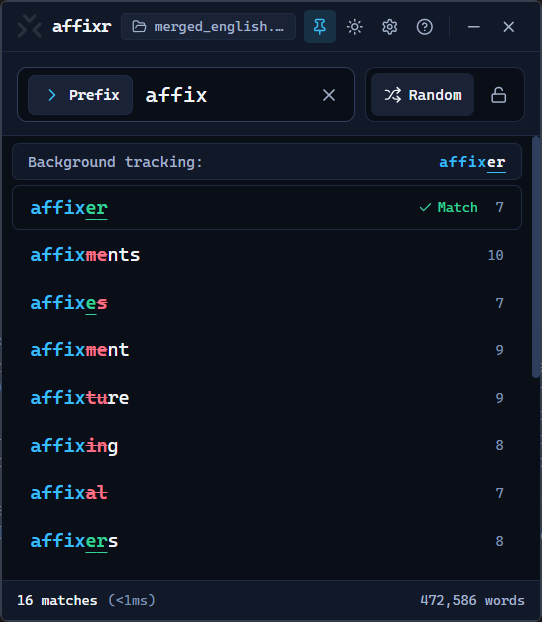
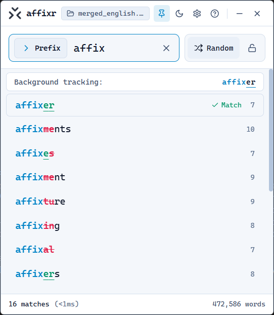

<p align="center">
  
</p>

<h1 align="center">Affixr</h1>

<p align="center">
  An ultra-fast, keyboard-driven desktop affix &amp; substring search utility built with <strong>Rust + Tauri v2</strong>, <strong>React 19</strong>, <strong>Tailwind CSS</strong>, and <strong>Cascadia Mono</strong> typography.
</p>

<p align="center">
  
  &nbsp;&nbsp;
  
</p>

---

## Features

| Feature | Detail |
|---|---|
| **Three Search Modes (`Tab`)** | Cycle seamlessly between **Prefix** (`>`), **Suffix** (`<`), and **Contains** (`v`) using `Tab` |
| **Sub-millisecond Rust Engine** | Binary search (`partition_point`) on forward and reversed index tables + Rayon parallel substring scan on 472k+ words |
| **Cascadia Mono Theme** | Engineered around **Cascadia Mono** with tabular numerals, 4 text-scale presets, and optional wide tracking |
| **Light, Dark & High Contrast** | Instant Light/Dark toggle, system sync, WCAG AAA High-Contrast mode, and Reduced Motion support |
| **Sort Order & Padlock** | Mouse-click sort toggle (`Short` → `Random` → `Long`, defaulting to `Random`) with a padlock button to freeze order |
| **Background Typing Tracker** | Passive out-of-focus OS keyboard hook highlights candidate letters green/red while you type in external apps, marking exact matches used on `Enter` |
| **On-the-Fly Wordlist Switching** | Press `F1` or click the active dictionary pill in the titlebar to load any `.txt` word list |
| **Spotlight Floating Window** | Always-on-top frameless panel with custom drag bar and automatic input focus recovery |

---

## Keyboard Reference

| Key / Input | Action |
|---|---|
| Any letter | Instant search in active mode |
| `Backspace` | Edit query and refresh results |
| `Tab` | Cycle search mode: **Prefix** (`ChevronRight`) → **Suffix** (`ChevronLeft`) → **Contains** (`ChevronDown`) |
| `↑` / `↓` | Move keyboard highlight through results |
| `Enter` | Mark highlighted word as **used** & clear input |
| `Escape` | Clear search field (or close open modal) |
| `F1` | Open file picker to switch `.txt` word list |
| Mouse click on Sort | Cycle sort order (`Short` → `Random` → `Long`) when unlocked |

---

## Development & Build

### Prerequisites

- **Rust** (`rustup`, `cargo >= 1.80`)
- **Node.js** (`>= 20`) and **pnpm** (`>= 9`)

### Setup & Run

```bash
# Install frontend dependencies
pnpm install

# Launch Tauri desktop app in development mode
pnpm tauri dev

# Run Rust engine unit tests
cargo test --manifest-path src-tauri/Cargo.toml

# Build production executable & installer
pnpm tauri build
```

---

## Project Structure

```
affixr/
├── assets/
│   └── logo.png                 # Application brand icon
├── merged_english.txt           # Bundled 472,677-word English dictionary
├── src/                         # React 19 + TypeScript + Tailwind frontend
│   ├── components/
│   │   ├── TitleBar.tsx         # Custom draggable Spotlight header
│   │   ├── SearchBar.tsx        # Input bar + Sort & Lock controls
│   │   ├── SearchModePill.tsx   # Prefix / Suffix / Contains pill with Lucide chevrons
│   │   ├── ResultsList.tsx      # Result listbox & empty states
│   │   ├── ResultRow.tsx        # Sub-character highlight & background typing overlay
│   │   ├── StatusBar.tsx        # Match count, latency, used count & reset
│   │   ├── SettingsModal.tsx    # Theme, text scale, contrast & motion settings
│   │   └── HelpModal.tsx        # Tabbed in-app guide & shortcut reference
│   ├── hooks/
│   │   └── useAccessibility.ts  # Persistent theme & accessibility state
│   ├── lib/
│   │   └── tauri.ts             # Typed Tauri IPC bridge
│   └── types/
│       └── affixr.ts            # Shared TypeScript interfaces
└── src-tauri/                   # Rust + Tauri v2 backend
    ├── Cargo.toml
    ├── tauri.conf.json
    └── src/
        ├── engine.rs            # Forward/reverse binary search & Rayon substring engine
        ├── global_hook.rs       # Passive Win32 WH_KEYBOARD_LL background listener
        ├── commands.rs          # Tauri IPC handlers
        └── lib.rs               # Application builder
```

---

## License

MIT License — see [LICENSE](LICENSE).